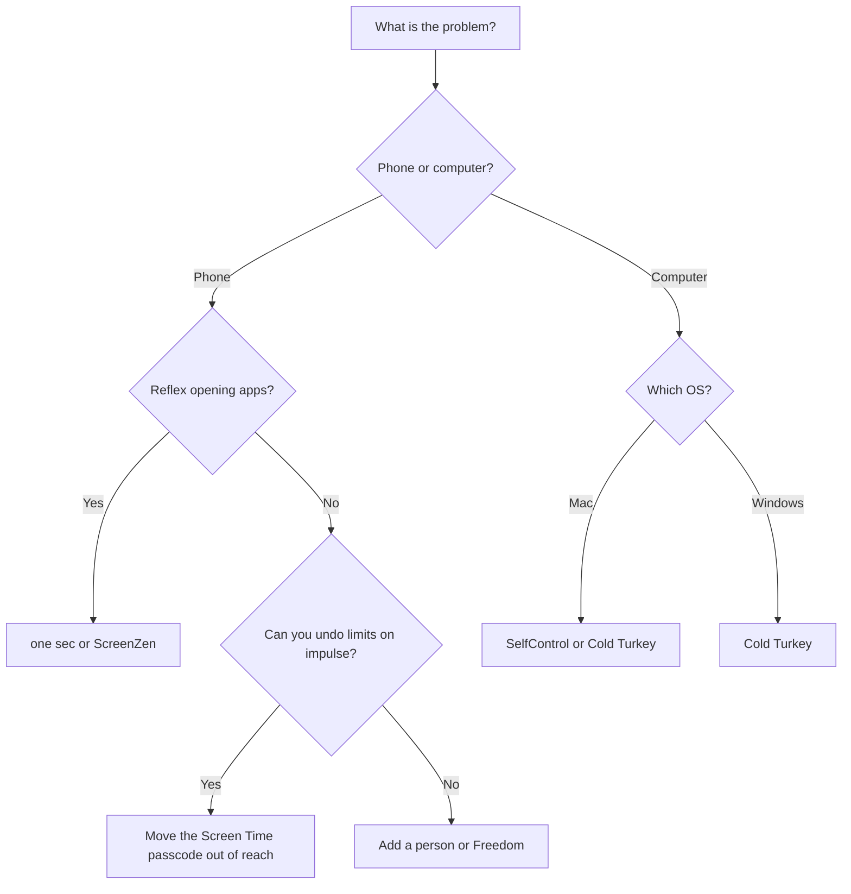

# :lucide-zap: Cheat sheet

Pick by goal. Prices come from each provider's site and can change.

## :lucide-route: Decision flow

## :lucide-wallet: Cost at a glance

=== "Free"

    - [Foqos](../iphone/foqos.md): free and open source, iPhone
    - [SelfControl](../mac/selfcontrol.md): free and open source, Mac
    - [ScreenZen](../iphone/screenzen.md): free, optional tips
    - [Freedom](../iphone/freedom.md): free tier with limited sessions

=== "Paid"

    - [Freedom](../iphone/freedom.md): $39.99 per year, or $199 one time
    - [Covenant Eyes](../iphone/covenant-eyes.md): $18 per month, $198 per year, or $950 lifetime
    - [Cold Turkey](../windows/cold-turkey.md): one-time purchase, prices on its site

=== "Pay what you want"

    - [password-locker.com](../iphone/password-locker.md): free for 30 days, then pay what you choose, including $0

## :lucide-keyboard: Quick keys

| Action | Shortcut |
| --- | --- |
| Open search on this site | ++s++ or ++slash++ |
| Next result | ++arrow-down++ |
| Close search | ++escape++ |

## :lucide-circle-help: Common answers

??? question "Which tool can't I end early?"

    SelfControl. Restarting or deleting the app doesn't end a block. Freedom's Locked Mode also stops you from quitting a session.
